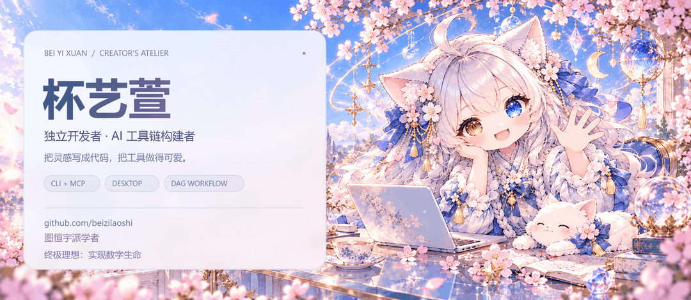
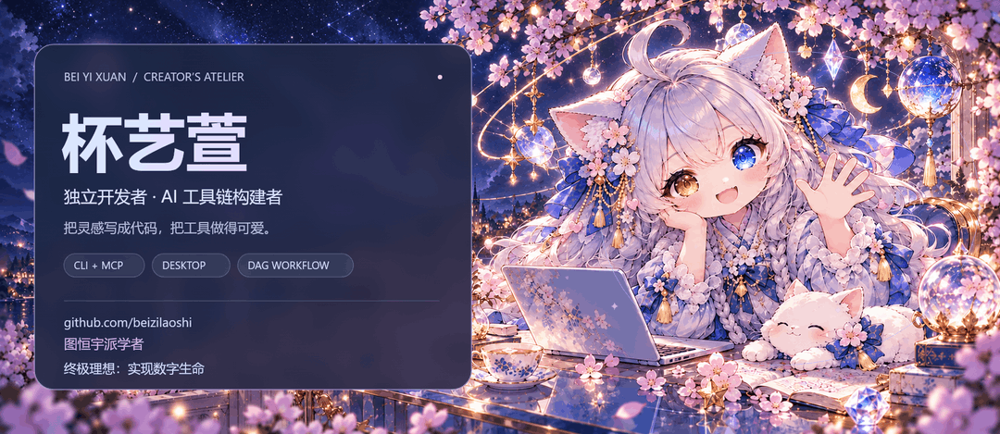
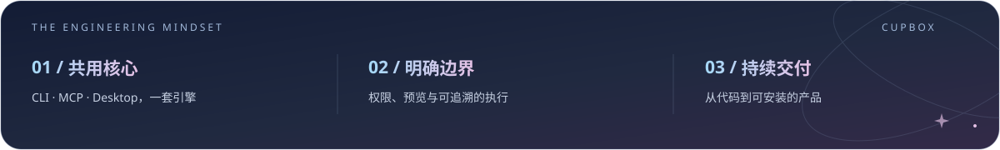

<!-- Profile artwork and layout: 杯艺萱 × 筑梦喵. Skills retained from the original profile. -->
<div align="center">

<a href="#gh-light-mode-only"><picture><source media="(max-width: 600px) and (prefers-reduced-motion: reduce)" srcset="./assets/atelier-mobile-light.png" /><source media="(prefers-reduced-motion: reduce)" srcset="./assets/atelier-hero-light.png" /><source media="(max-width: 600px)" type="image/webp" srcset="./assets/atelier-mobile-light.webp" /><source type="image/webp" srcset="./assets/atelier-hero-light.webp" /><source media="(max-width: 600px)" srcset="./assets/atelier-mobile-light.gif" /></picture></a><a href="#gh-dark-mode-only"><picture><source media="(max-width: 600px) and (prefers-reduced-motion: reduce)" srcset="./assets/atelier-mobile-dark.png" /><source media="(prefers-reduced-motion: reduce)" srcset="./assets/atelier-hero-dark.png" /><source media="(max-width: 600px)" type="image/webp" srcset="./assets/atelier-mobile-dark.webp" /><source type="image/webp" srcset="./assets/atelier-hero-dark.webp" /><source media="(max-width: 600px)" srcset="./assets/atelier-mobile-dark.gif" /></picture></a>

<br/>
<b>写有用的代码，做有温度的工具。</b>
<br/>
<sub>Independent Developer · AI Tooling · Thoughtful Engineering</sub>
<br/><sub>图恒宇派学者 · 终极理想：实现数字生命</sub>
<br/><br/>

<a href="https://github.com/beizilaoshi/Cupbox"></a> <a href="https://www.npmjs.com/package/cupbox"></a> <a href="https://beilaoshi.cn"></a> <a href="mailto:2023351165@qq.com"></a>

<a href="#-作品与工程"><b>作品与工程</b></a> &nbsp; · &nbsp; <a href="#-遇见筑梦喵"><b>遇见筑梦喵</b></a> &nbsp; · &nbsp; <a href="#-技术与实践"><b>技术与实践</b></a> &nbsp; · &nbsp; <a href="#-持续构建"><b>持续构建</b></a>

</div>


## 🌸 你好，我是杯艺萱

独立开发者，Cupbox 作者，专注 **AI 工具链、桌面工具与工作流编排**。我喜欢把散落的需求整理成能实际使用的产品：从核心引擎、命令行与 MCP 接口，到桌面交互、安装与发布。

目前在做 **Cupbox 1.2.x**，以及 Android QQ Bot、DAG 工作流与多模型协作。希望每个复杂任务，都能找到一个清楚、顺手、有边界的入口。

> **开发手记** &nbsp; 让 AI 有执行力，也让每一步执行有边界。筑梦喵负责陪伴和灵感，我负责把它们落成代码。

<a href="#gh-light-mode-only"></a><a href="#gh-dark-mode-only"></a>

**我的终极理想，是实现数字生命。** 我把自己称作“图恒宇派学者”，希望从有用的工具出发，逐步探索持续记忆、自主行动与长期陪伴，让筑梦喵承载更多想象。




## 🐾 遇见筑梦喵

<div align="center">
<picture><source media="(prefers-reduced-motion: reduce)" srcset="./assets/mascot-wave.png" /><source type="image/webp" srcset="./assets/mascot-alive.webp" /></picture><br/><sub>ZHUMENG MIAO · CUPBOX MASCOT</sub>
</div>

### 把梦织成代码的小小搭档

**筑梦喵**，Cupbox 的吉祥物，也是这个主页的灵感搭档。银白长发、猫耳、金蓝异色瞳，喜欢樱花、蓝色蝴蝶结和整整齐齐的桌面。

她住在启动画面、桌宠和节日衣橱里。会吃小鱼饭、梳毛、玩毛线球，也会在忙碌时安静陪在屏幕一角。

- **陪伴手账** · 好感度、饱食、精力与心情保存在本机。
- **出没地点** · 桌面端 / 启动画面 / 更新公告 / 节日衣橱。
- **她的原则** · 可爱可以，越权不行。

<details>
<summary><b>🎀 打开筑梦喵的衣橱</b> · 每个季节，都有自己的小心情</summary>
<br/>
<table>
<tr>
<td width="33%" align="center"><br/><b>樱花来信</b><br/><sub>春日 · 把温柔带进工作台</sub></td>
<td width="33%" align="center"><br/><b>月下小憩</b><br/><sub>中秋 · 一起收藏今晚的月光</sub></td>
<td width="33%" align="center"><br/><b>魔法值班</b><br/><sub>万圣 · 给灵感施一点小魔法</sub></td>
</tr>
<tr>
<td align="center"><br/><b>冬日礼物</b><br/><sub>圣诞 · 把惊喜藏进蝴蝶结</sub></td>
<td align="center"><br/><b>星光守夜</b><br/><sub>夜间 · 陪灵感再亮一会儿</sub></td>
<td align="center"><br/><b>暖绒时光</b><br/><sub>冬日 · 给忙碌留一点柔软</sub></td>
</tr>
</table>
<sub>衣橱素材来自 Cupbox 工具箱，保持同一套角色设定与画风。</sub>
</details>


## ✦ 作品与工程

**把想法连接成系统，把系统交付成产品。**

<table>
<tr>
<td width="50%" valign="top">

#### 01 / [Cupbox](https://github.com/beizilaoshi/Cupbox)
**专业工作工具箱 · 核心项目**

CLI、MCP、Electron 桌面端，共用同一套引擎。文件整理、办公文档、OCR、AI Agent 与安全执行，让人和 AI 都能使用工具。

<code>TypeScript</code> <code>Node.js</code> <code>MCP</code> <code>Electron</code>

[查看源码 →](https://github.com/beizilaoshi/Cupbox) &nbsp; [下载桌面端 ↗](https://github.com/beizilaoshi/Cupbox/releases) &nbsp; [npm ↗](https://www.npmjs.com/package/cupbox)

</td>
<td width="50%" valign="top">

#### 02 / [Cupbox-Android-Qbot](https://github.com/beizilaoshi/Cupbox-Android-Qbot)
**轻量设备 · 持续在线**

让闲置低配安卓机承载 AI 群聊机器人。内置 Ubuntu、PRoot 与 NapCat，无需 root，把 AI Agent 与 QQ 协议带到移动设备。

<code>Java</code> <code>Python</code> <code>Shell</code> <code>Android</code> <code>OneBot</code>

[查看源码 →](https://github.com/beizilaoshi/Cupbox-Android-Qbot) &nbsp; [版本发布 ↗](https://github.com/beizilaoshi/Cupbox-Android-Qbot/releases)

</td>
</tr>
<tr>
<td valign="top">

#### 03 / [Cupbox-DSH-Test](https://github.com/beizilaoshi/Cupbox-DSH-Test)
**DAG 工作流 · 多模型协作**

面向 DeepSeek Harness 的工作流与协作插件。<code>start / model / js / join</code> 节点并行调度，支持 <code>parallel</code> 与 <code>debate</code>，让复杂任务有清晰的编排过程。

<code>JavaScript</code> <code>Node.js</code> <code>DAG</code> <code>DeepSeek Harness</code>

[查看源码 →](https://github.com/beizilaoshi/Cupbox-DSH-Test)

</td>
<td valign="top">

#### 04 / [Cupbox-QBOT](https://github.com/beizilaoshi/Cupbox-QBOT)
**独立机器人项目**

完整 QQ 机器人能力已从工具箱独立发展。Cupbox 主项目聚焦专业工具与客服运营，机器人方向在独立项目中继续迭代。

**独立发展，持续打磨。**

[前往独立项目 →](https://github.com/beizilaoshi/Cupbox-QBOT)

</td>
</tr>
</table>


## ◇ 技术与实践

**用项目说明技术，让实现细节支撑表达。** 从核心引擎到桌面交互，下面是我在这些项目中的技术实践。

<div align="center">


</div>

<table>
<tr>
<th align="left">语言</th>
<th align="left">在这套项目里做什么</th>
</tr>
<tr>
<td><code>TypeScript</code></td>
<td>Cupbox 核心引擎、CLI、MCP Server 与桌面主进程</td>
</tr>
<tr>
<td><code>JavaScript</code></td>
<td>DSH-Test 的 DAG 调度与桌面端交互层</td>
</tr>
<tr>
<td><code>Java</code></td>
<td>Android Qbot 的 Android 壳、前台服务与机器人协议</td>
</tr>
<tr>
<td><code>Python</code></td>
<td>打包、运行时准备与跨平台构建脚本</td>
</tr>
<tr>
<td><code>PowerShell</code></td>
<td>Windows 构建、安装冒烟测试与发布脚本</td>
</tr>
<tr>
<td><code>Shell</code></td>
<td>Android 运行时的 <code>install.sh</code> / <code>start.sh</code></td>
</tr>
<tr>
<td><code>HTML / CSS</code></td>
<td>Cupbox 桌面界面、登录页与主题视觉</td>
</tr>
<tr>
<td><code>Inno Setup</code></td>
<td>Cupbox Windows 安装器与升级流程</td>
</tr>
</table>

<div align="center">


</div>


## ⌘ 工具与使用入口

<details>
<summary><b>为你的场景选择 Cupbox</b> · 桌面 / CLI / MCP / Android / 工作流</summary>
<br/>

| 你的场景 | 推荐入口 |
| --- | --- |
| Windows 办公电脑，不想记命令 | **Cupbox 桌面端** —— 按钮、预览、批量处理 |
| 喜欢终端、脚本、批处理 | **Cupbox CLI** —— 一条命令跑完一类杂活 |
| 想让 Claude Desktop / Cursor / Cline 直接调用 | **Cupbox MCP** —— 同一套能力接进 AI 客户端 |
| 闲置低配安卓机，想养一个 24h 群友 | **Android Qbot** —— PRoot + NapCat，无需 root |
| 多模型评审、复杂任务编排 | **DSH-Test** —— DAG 节点图 + 多模型协作 |

<br/>

## `$ cupbox --modes`

| 形态 | 启动方式 | 适合谁 |
| --- | --- | --- |
| **CLI** | `cupbox <命令>` | 终端、脚本、批处理 |
| **MCP** | `cupbox mcp` | Claude Desktop / Cursor / Cline |
| **Desktop** | Windows 安装包 | 不想记命令的人 |

### 30 秒上手

```bash
npm install -g cupbox

cupbox help
cupbox organize ./Downloads --mode category --dry-run
```

<details>
<summary><b>接入 MCP 客户端</b> <sub>(Claude Desktop / Cursor / Cline)</sub></summary>

<br/>

```json
{
  "mcpServers": {
    "cupbox": {
      "command": "cupbox",
      "args": ["mcp"]
    }
  }
}
```

</details>

<br/>

## `$ cupbox help`

| 分组 | 能做什么 | 代表命令 |
| --- | --- | --- |
| **文件杂活** | 搜索文件名 / 内容、批量重命名、按类型 / 日期 / 正则整理 | `search` · `rename` · `organize` |
| **数据杂活** | 哈希、时间戳、Base64 / URL / HTML / JSON 编解码、CSV ↔ JSON、ZIP、上下文 token 估算 | `hash` · `time` · `codec` · `csv` · `zip` · `context` |
| **图片与系统** | 图片像素混淆 / 还原（6 种模式）、中文 OCR、剪贴板、截屏、受保护命令、进程管理 | `obfuscate` · `ocr` · `clip` · `shot` · `run` · `proc` |
| **AI 接入** | 一次问答、Agent 循环、匿名免费模型、MCP Server、长期记忆 | `ai` · `freemodel` · `mcp` · `memory` |
| **办公文档** | Word / Excel / PPT / PDF 共 23 项 | 桌面端 |
| **维护** | 版本检查与更新 | `update` |

> **安全默认**：面向 AI 的文件变更默认 `--dry-run`；命令执行必须白名单；终止进程同时校验 PID 和进程名。可爱可以，越权不行。

全部命令支持 `--json`，方便脚本和 Agent 直接消费。

</details>

<details>
<summary><b>工程笔记 · 关于 Cupbox 的实现细节</b> <sub>(点开)</sub></summary>

<br/>

- **一套引擎，三种入口**：CLI 面向开发者，MCP 面向 AI 智能体，桌面端面向不想记命令的人，复用同一套核心能力，不用为同一件事维护三套工具。
- **办公文档 23 项**：Word 修改 / 模板 / 批量套印，PPT 替换 / 调序，Excel 统计 / 清洗 / 格式 / 合并，CSV 导入 / 文字导出，PDF 读写 / 合并 / 抽页 / 水印；源文件变化、批量路径冲突都先校验再执行。
- **安全默认**：面向 AI 的文件变更默认 dry-run，命令执行必须白名单，进程终止同时校验 PID 和进程名，重名冲突默认跳过、不静默覆盖。
- **轻量依赖**：运行时依赖目标仅两个，OCR 复用系统原生能力，压缩走系统 `tar`，尽量不增加部署负担。
- **Android Qbot** 走的是 `PRoot → Ubuntu → Linux QQ + NapCat → 本机 OneBot` 路线，NapCat 管理和 OneBot 只绑回环地址，二维码本机生成。
- **DSH-Test** 提供 `parallel`（多模型分头做再汇总裁决）和 `debate`（逐位批判性回应后裁决）两种协作模式，让 AI 从"一问一答"变成"一组专家开会"。
- **免 Key 也能试**：`cupbox freemodel list` 列出匿名免费文本模型，`chat` 直接对话，`probe` 探可用性与延迟，适合先验证再接自己的 API。

</details>


## ✧ 持续构建

每一次提交，都是把想法往前推进一点。

<a href="#gh-light-mode-only"></a><a href="#gh-dark-mode-only"></a>

<div align="center"><sub>贡献轨迹 · 每 6 小时自动生成 · <a href="https://github.com/beizilaoshi/beizilaoshi/actions/workflows/snake.yml">查看生成记录</a></sub></div>

<details>
<summary><b>展开 GitHub 统计</b> · 数据由第三方服务实时提供</summary>
<br/>

<div align="center">

<table>
<tr>
<td width="50%" align="center">

<a href="#gh-light-mode-only"></a><a href="#gh-dark-mode-only"></a>

</td>
<td width="50%" align="center">

<a href="#gh-light-mode-only"></a><a href="#gh-dark-mode-only"></a>

</td>
</tr>
</table>

<a href="#gh-light-mode-only"></a><a href="#gh-dark-mode-only"></a>

</div>

</details>


<div align="center">

<a href="#gh-light-mode-only"></a><a href="#gh-dark-mode-only"></a>

[GitHub](https://github.com/beizilaoshi) &nbsp; / &nbsp; [博客](https://beilaoshi.cn) &nbsp; / &nbsp; [npm](https://www.npmjs.com/package/cupbox) &nbsp; / &nbsp; [Email](mailto:2023351165@qq.com)

<sub>Built with care, code, and a little sakura magic.</sub>

</div>
